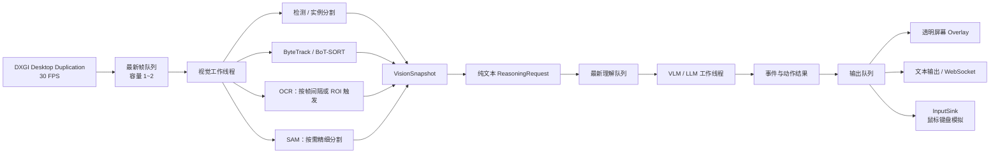

# ACEYE 架构

ACEYE 是一个面向 Windows 桌面的实时视觉编排层。当前仓库先把消息契约、线程边界和模块接口固定下来，具体模型可以在后续任务中替换，不需要重写主循环。

## 运行图

捕获、视觉、理解和输出分别在独立工作边界内运行。每个跨线程队列只保留最新内容，处理落后时丢弃过时帧，避免延迟不断累积。理解层不阻塞屏幕检测层，因此 VLM/LLM 可以按事件或约 0.5–2 Hz 调度，而检测和跟踪仍可保持目标帧率。

## 消息契约

- `FrameBuffer`：捕获线程产生的 BGRA 图像和帧序号。
- `VisionSnapshot`：检测、跟踪、OCR、mask 摘要和帧元数据的统一结果。
- `ReasoningRequest`：把当前快照格式化成可直接交给 VLM/LLM 的纯文本，同时保留结构化快照供适配器使用。
- `ReasoningResult`：场景、事件、文本反馈和候选 `InputAction`。
- `OverlayFrame`：屏幕坐标中的矩形、标签、文本和轨迹等绘制原语。
- `OutputPacket`：把理解结果同时送往 Overlay、文本通道和输入通道。

模型适配器只依赖这些契约。TensorRT/YOLO、PaddleOCR、SAM、Qwen 或其他本地/远程模型都可以实现对应接口；没有安装模型时，空实现仍能让整个运行图启动和自检。

## 输出策略

ACEYE 不把实时预览窗口作为产品输出。运行图输出的是透明屏幕 Overlay 契约，它只绘制检测框、标签、事件和状态信息；当前骨架使用内存 sink 保存最新原语，后续任务可直接替换为 Win32 分层窗口、游戏内叠加层或其他渲染后端。捕获源不会被额外的预览窗口递归捕获。

理解通道使用文本优先的协议。视觉线程将 OCR 和结构化目标整理成短文本，理解线程再把它交给 VLM/LLM，并要求返回受约束的 JSON 或等价结构。文本通道也可以直接连接日志、WebSocket 或外部代理，而不需要读取图像。

输入自动化通过 `IInputSink` 隔离。`InputAction` 描述鼠标移动、按键按下/释放、文本输入和等待等动作。`automation_enabled` 默认为 `false`；关闭时动作只会被记录为待处理结果，不会调用 Windows 输入 API。只有在明确启用配置并接入经过审核的输入适配器后，才执行真实鼠标和键盘事件。

## 调度原则

1. 捕获线程只负责取得最新屏幕帧。
2. 视觉线程每帧执行检测和跟踪，OCR/SAM 由节流器或事件触发器调度。
3. 理解线程消费最新 `ReasoningRequest`，绝不反压检测线程。
4. 输出线程按需发布 Overlay、文本和动作；任一输出后端变慢都不能阻塞捕获。
5. 所有线程在停止时排空有限队列后退出，避免遗留后台线程。

## 配置边界

运行参数集中在 `RuntimeConfig`，`config/aceye.json` 是对应的配置模板；当前骨架由宿主代码组装 `RuntimeConfig`，后续任务可以接入 JSON 加载而不改变运行图。目标帧率、OCR 间隔、理解频率、队列容量、Overlay/文本开关以及自动化开关都不写死在模型代码中。
